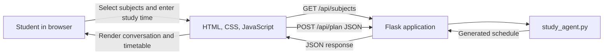

# Study Buddy: Student Study Planner

Study Buddy is a small, local web application that turns the original terminal-based study planner into a guided chat experience. Choose supported subjects, enter how many days remain before an exam, and set a daily study-hour target to receive a topic-by-topic schedule.

This is a rule-based planner, not a machine-learning or generative-AI application. It runs locally and does not require an account, API key, or internet connection after Flask has been installed.

## Problem

When several subjects need attention, it can be hard to decide what to study first and how to use the days before an exam. The original script already supplied subject topics and a straightforward scheduling rule, but required users to enter information through a terminal.

## Objectives

- Keep the original supported subjects, topic lists, and schedule calculations.
- Make the inputs approachable through a conversational web interface.
- Display the schedule returned by Python, not a sample or hardcoded plan.
- Keep the project easy to install, run, and customize for a college demonstration.

## Features

- Guided chat flow for selecting subjects, days until an exam, and study hours per day.
- Subject choices and topic lists are served by Flask from the Python planner module.
- Topic scheduling follows the original round-robin order.
- A 30-minute quick revision is reserved on topic days when daily study time is greater than 30 minutes.
- Days with no newly assigned topics include revision of all subjects and practice of important questions.
- Schedule overview and daily task lists are generated from the API response.
- Input validation in both the browser and Flask API, plus loading, retry, and reset behavior.
- Responsive layout and accessible focus styles.

## Technologies

- Python 3.10 or newer
- Flask
- HTML, CSS, and vanilla JavaScript (`fetch`)
- Python `unittest` for API checks

## How the planner works

The planner has a fixed topic list for each supported subject: OS, DBMS, Java, and Python. It combines the selected topic lists in the order selected, then assigns each topic to a day using its position in that combined list. For example, with four days, topic 1 goes to day 1, topic 2 to day 2, topic 5 returns to day 1, and so on.

On a day with topics, the planner divides the available study time (minus 0.5 hour when possible) evenly across that day's topics. Each topic duration is rounded to one decimal place, as in the original script. When daily study time is 0.5 hour or less, all of that time is assigned to the topics and no separate quick-revision task is added. Any remaining days receive a full-day revision task and an untimed practice task.

The schedule is a simple study outline. It does not calculate calendar dates, subject difficulty, priorities, reminders, or actual completion progress because those features were not part of the original planner.

## Architecture



## Project structure

```text
study plan agent/
├── app.py
├── study_agent.py
├── test_app.py
├── requirements.txt
├── README.md
├── .gitignore
├── templates/
│   └── index.html
└── static/
    ├── script.js
    └── style.css
```

## Run on Windows

### Prerequisites

- Python 3.10 or newer installed and available in PowerShell as `py` or `python`.
- VS Code or another editor (optional).

Open PowerShell in the project folder, then create and activate a virtual environment:

```powershell
cd "C:\path\to\AI_Agents\study plan agent"
py -3.10 -m venv .venv
.\.venv\Scripts\Activate.ps1
```

If PowerShell blocks activation, allow locally created scripts for your user and try activation again:

```powershell
Set-ExecutionPolicy -Scope CurrentUser RemoteSigned
.\.venv\Scripts\Activate.ps1
```

Install the dependency and start Flask:

```powershell
python -m pip install --upgrade pip
python -m pip install -r requirements.txt
python app.py
```

Open **http://127.0.0.1:5000** in your browser. To stop the local server, press `Ctrl+C` in PowerShell.

## Example request

The browser sends a request like this to `POST /api/plan`:

```json
{
  "subjects": ["OS"],
  "days": 6,
  "hours_per_day": 2
}
```

The response contains the plan created by `study_agent.py`: four OS topics, assigned in their original order, spread across the six requested days. Topic days include their calculated topic durations and a 0.5-hour quick revision. Days with no new topic include revision of all subjects and an important-questions practice task.

The API accepts one or more supported subjects, 1–365 days, and more than 0 through 24 study hours per day. Invalid or malformed input returns a JSON error with HTTP status `400`.

## Data and privacy

The original script did not save student data, and this version does not add persistent storage. Plans exist in the current browser session only; refreshing the page or closing it clears the conversation and plan. There is no progress tracking or save/load feature. The app collects no student name or personal information.

## Screenshots

Screenshots can be added later in a `screenshots/` folder and linked here. For example:

```markdown

```

Capture the running application in a browser after generating a plan, then add the image to that folder.

## Customize the project

- **Subjects and topic lists:** edit `SUBJECT_TOPICS` in `study_agent.py`. The interface obtains its choices from `GET /api/subjects`.
- **Scheduling rule:** update `generate_study_plan()` in `study_agent.py`; keep the Flask route focused on input/output handling.
- **Conversation and rendering:** update `static/script.js` and `templates/index.html`.
- **Colors and layout:** adjust the CSS variables near the top of `static/style.css`.
- **API behavior:** update the routes in `app.py` and their checks in `test_app.py`.

## Tests

From the project folder, run:

```powershell
python -m unittest discover -s . -p "test_*.py"
```

The tests cover subject choices, topic ordering, revision-only days, invalid values, and malformed JSON requests.

## Troubleshooting

- **`python` or `py` is not recognized:** install Python and enable the option to add it to `PATH`, then open a new PowerShell window.
- **`No module named flask`:** activate the virtual environment in the project folder and run `python -m pip install -r requirements.txt`.
- **PowerShell blocks virtual-environment activation:** use the `Set-ExecutionPolicy` command shown above, or run `.\.venv\Scripts\python.exe app.py` without activating the environment.
- **Port 5000 is already in use:** stop the other local server, or change the port in the final `app.run(...)` line of `app.py` and open that port in the browser.
- **The page does not load when opening the HTML file directly:** start Flask with `python app.py` and use `http://127.0.0.1:5000`; the page needs the backend API.

## Upload to GitHub

Create an empty repository on GitHub, then run these commands from the project folder. Replace the example URL with your repository URL.

```powershell
git init
git add .
git commit -m "Build Study Buddy study planner"
git branch -M main
git remote add origin https://github.com/YOUR-USERNAME/YOUR-REPOSITORY.git
git push -u origin main
```

The `.gitignore` excludes virtual environments, Python cache files, environment files, editor settings, and common operating-system files. Review `git status` before uploading to ensure no private information has been added.

## Future enhancements

- Optional saved plans and progress tracking using a local JSON file.
- Custom subjects, topics, exam dates, and study preferences.
- Calendar dates and rescheduling after a missed session.
- More detailed tests for unusual study-hour values and multiple subjects.

## Conclusion

Study Buddy keeps the original planner's subject topics and scheduling behavior, while making the process easier to follow in a browser. Its small Flask backend and plain frontend files are intended to be understandable and simple to extend.