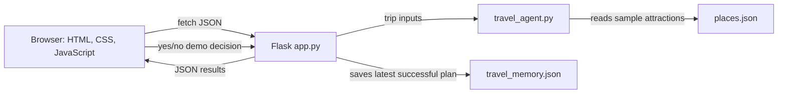

# TravelMate AI — Smart Travel Planning Agent

TravelMate AI is a beginner-friendly local web application for making sample travel plans for Mysuru and Ooty. It combines a Python travel planner with a Flask API, an HTML/CSS/JavaScript dashboard, local JSON attraction data, and persistent trip memory.

> **Demonstration only:** Attraction costs and open/closed statuses are supplied sample values. They are not live, current, or verified travel information. The application does not make reservations, payments, or external service calls.

## Problem Statement

Planning a short trip involves comparing attractions, estimating everyday costs, and deciding how to use a limited budget. For a classroom demonstration, it is useful to see those steps in one place without relying on live travel services or making real bookings.

## Project Objectives

- Connect an existing Python travel-planning exercise to a usable web interface.
- Keep sample destination information in a simple editable JSON file.
- Explain budget calculations and any changes made during budget replanning.
- Generate an understandable day-by-day sample itinerary.
- Remember the most recently planned trip locally.
- Demonstrate an explicit approval flow without carrying out a booking.

## Features

- Responsive trip planner with destination, days, budget, and travel style inputs.
- Mysuru and Ooty attraction cards loaded from the Flask API.
- Sample cost and sample opening-status labels on each attraction.
- Budget estimates for attraction entry, food, and transport.
- Budget replanning that removes the most expensive open attractions first.
- Day-by-day itinerary with rest/exploration days when there are no remaining attractions.
- Local `travel_memory.json` persistence for the latest trip and travel style.
- Refreshable last-saved-trip section.
- Yes/no booking-approval demonstration. Neither choice creates a real booking.
- Existing command-line travel planner remains available in `travel_agent.py`.
- No AI model, paid API, API key, database server, frontend framework, or external image service.

## Technologies

- Python 3.10 or later
- Flask
- HTML5, CSS3, and browser JavaScript
- JSON files for local attraction data and saved travel memory
- Python `unittest` for API and planning tests

## How the Application Works

The browser loads the page from Flask. JavaScript fetches destination data and saved memory, submits the trip form to the planning API, and renders the returned budget and itinerary. Python calls the original planning module to calculate estimates and replan. The most recent successful plan is written atomically to a local JSON memory file.



## Project Structure

```text
travel agent/
├── app.py
├── travel_agent.py
├── places.json
├── travel_memory.json          # local runtime data; excluded by .gitignore
├── travel_memory.example.json  # safe empty example for GitHub
├── requirements.txt
├── test_app.py
├── README.md
├── .gitignore
├── templates/
│   └── index.html
└── static/
    ├── style.css
    └── script.js
```

## Prerequisites on Windows

- Windows 10 or 11
- Python 3.10+ available as `py` or `python`
- VS Code (recommended, but not required)

## Installation and Running

1. Open VS Code, choose **File → Open Folder...**, and select the existing `travel agent` folder.
2. Choose **Terminal → New Terminal**. Confirm the terminal is in the project folder. If the terminal opened at the parent workspace folder, run:

   ```powershell
   cd "travel agent"
   ```

3. Create a virtual environment:

   ```powershell
   py -m venv .venv
   ```

4. Activate it in PowerShell:

   ```powershell
   .venv\Scripts\Activate.ps1
   ```

   If script activation is blocked, allow activation for only the current terminal and try again:

   ```powershell
   Set-ExecutionPolicy -Scope Process -ExecutionPolicy Bypass
   .venv\Scripts\Activate.ps1
   ```

   Alternatively, in Command Prompt use `.venv\Scripts\activate.bat`.

5. Install the one dependency:

   ```powershell
   python -m pip install -r requirements.txt
   ```

6. Start the local development server:

   ```powershell
   python app.py
   ```

7. Open **http://127.0.0.1:5000**. Keep the terminal running while using the app. Press **Ctrl+C** to stop Flask.

The page uses local assets and local APIs. Once Flask is installed, the interface does not require an internet connection.

## Try a Trip

Try **Mysuru**, **2 days**, a **₹5,000** budget, and **History**. The sample attraction entries total ₹150; food is ₹1,000; transport is ₹600; and the estimate is **₹1,750**. The plan should fit the budget and save this trip in local memory.

Try **Ooty**, **2 days**, a **₹5,000** budget, and **Nature**. The Toy Train remains visible with a “Closed in sample data” label and is excluded from the available itinerary. The estimate is **₹1,680**.

Try **Ooty**, **2 days**, a **₹100** budget, and **Relaxation**. The planner initially estimates ₹1,680, then removes Botanical Garden (₹50) and Ooty Lake (₹30). Food and transport alone total ₹1,600, so the revised plan still exceeds the budget. The entered budget stays ₹100 and the interface explains that a feasible plan was not found.

## Sample Attraction Data

The initial values are stored only in `places.json`:

| Destination | Attraction | Sample entry cost | Sample status |
|---|---|---:|---|
| Mysuru | Mysore Palace | ₹100 | Open |
| Mysuru | Brindavan Gardens | ₹50 | Open |
| Mysuru | Chamundi Hills | ₹0 | Open |
| Ooty | Botanical Garden | ₹50 | Open |
| Ooty | Ooty Lake | ₹30 | Open |
| Ooty | Toy Train | ₹250 | Closed |

These are values for the assignment only. “Open” and “Closed” describe the sample file; they do not describe current real-world operations.

## Budget Calculation

The application retains the original demonstration formulas:

```text
Attraction expenses = sum of available sample attraction costs
Food estimate       = number of days × ₹500
Transport estimate  = number of days × ₹300
Estimated total     = attraction expenses + food estimate + transport estimate
```

Only attractions marked open in the local sample data are included in the starting estimate. The user's budget is not changed. If the initial estimate is too high, the planner removes the most expensive available attractions one at a time and recalculates after every removal. Free attractions are retained when removing them cannot reduce the estimate. If the fixed food and transport estimates still exceed the budget, the app reports that no feasible plan was found.

The itinerary lists the remaining attractions once, one per day, followed by flexible exploration/rest days if the trip is longer than the remaining list. Any additional attractions after the last trip day remain visible in the attraction cards and budget calculation. This is a sample itinerary, not a transport schedule or opening-hours check.

## Travel Memory

`travel_memory.json` stores two top-level values: `preferences` and `last_trip`. After a valid plan is generated, the application atomically writes the selected destination, day count, entered budget, travel style, and final estimated cost. Flask reads the file when the memory endpoint is requested; it does not replace a valid existing file just because the app starts.

If the file is missing, empty, unreadable, or invalid JSON, the app returns sensible empty defaults. The first successful plan creates or replaces it. **Reset planner** only clears the current form/results; it does not delete saved memory. `travel_memory.example.json` is the safe, empty file intended for GitHub. `.gitignore` excludes the local runtime `travel_memory.json` so personal trip details are not accidentally uploaded.

## Booking Approval Demonstration

Choose **Request Booking Approval**, then explicitly choose **Yes, approve demo** or **No, decline**. The API returns a corresponding demo message. Yes only records that the demo step was approved; no reservation, payment, or external action occurs. The app has no booking provider integration.

## API Endpoints

| Method | Endpoint | Purpose |
|---|---|---|
| `GET` | `/api/destinations` | Read local destination and attraction data |
| `POST` | `/api/plan` | Validate input, calculate budget, replan, create itinerary, and save memory |
| `GET` | `/api/memory` | Read saved preference and latest trip |
| `POST` | `/api/booking-approval` | Return the explicit demo approval decision; never book |

Errors use JSON and suitable status codes. Invalid or missing trip fields return `400`; unavailable files return a safe error; unexpected API failures do not expose tracebacks or local paths.

## Modify Destinations

Edit `places.json` to change the sample destinations or attractions. Each destination maps to a list of objects with a `name`, non-negative demonstration `cost`, and boolean `open` field. Keep the JSON syntax valid. Restart Flask after editing; both the destination cards and planner read the same local data file.

## Tests

From the project folder, activate the virtual environment and run:

```powershell
python -m unittest -v
```

The test suite covers supplied data, the Mysuru and Ooty estimates, closed-attraction exclusion, over-budget removal and infeasibility, malformed/invalid requests, missing or invalid memory, and both safe approval decisions. Tests use a temporary memory file and do not replace the project's existing travel memory.

## Screenshots

Screenshots can be added later to a `screenshots/` folder. Capture the dashboard, a Mysuru plan within budget, an Ooty plan showing the closed sample Toy Train, and the low-budget replan. Add them to this section with Markdown links once captured. Do not use screenshots to imply live prices, live hours, or real bookings.

## Troubleshooting

- **`py` is not recognized:** Install Python from python.org, enable the launcher option, reopen PowerShell, and check `py --version`.
- **PowerShell blocks virtual-environment activation:** Use the current-terminal execution-policy command above or activate from Command Prompt.
- **Flask cannot be imported:** Confirm `.venv` is active and run `python -m pip install -r requirements.txt` from this folder.
- **The browser cannot connect:** Confirm `python app.py` is still running and open `http://127.0.0.1:5000`.
- **Destination cards do not load:** Confirm `places.json` is valid JSON and that Flask is running from this project; file paths are resolved relative to the Python module.
- **Saved trip is empty:** Generate a valid plan. The app creates memory only after successfully saving a trip.
- **Do not see a recent change:** Refresh the page. Restart Flask after changing Python code or the sample data.

## Upload to a New GitHub Repository

These commands initialize and push only this folder when run from inside it. Create an empty repository on GitHub first, then replace `YOUR-USERNAME` and `YOUR-REPOSITORY` below. Nothing is committed or pushed automatically by this project.

```powershell
cd "travel agent"
git init
git add .
git status
git commit -m "Build TravelMate AI trip planner"
git branch -M main
git remote add origin https://github.com/YOUR-USERNAME/YOUR-REPOSITORY.git
git push -u origin main
```

Check `git status` before committing. `.gitignore` excludes `travel_memory.json`, `.env`, virtual environments, Python cache files, and common editor/OS temporary files. The empty `travel_memory.example.json` can be included safely.

## Future Enhancements

- Add student-created destinations and attractions through a validated editor.
- Add export of an itinerary as a printable document.
- Add optional local weather/transport data only with clear source, freshness, and availability labels.
- Improve itinerary allocation while continuing to distinguish estimates from verified information.

## Conclusion

TravelMate AI demonstrates how a small Python planning module can become a full-stack local application. Its estimates, itinerary, memory, and booking flow are transparent classroom features; it does not claim to be a live travel service or an AI model.